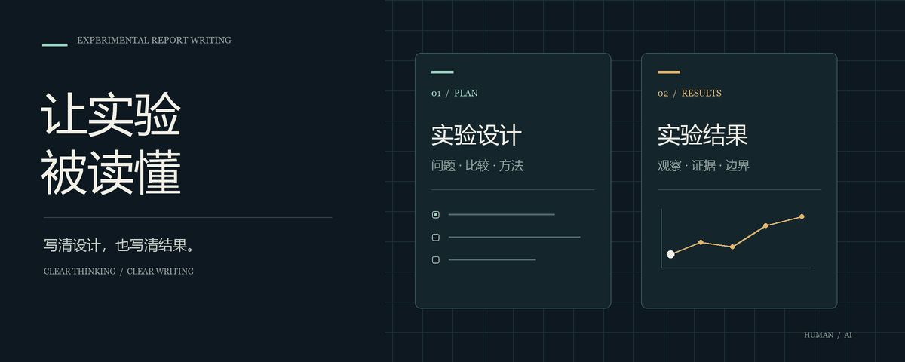

# Experimental Report Writing

**核心不是让 AI 替代人类写报告，而是让 AI 能写出人能看得懂的报告。**

实验报告需要说清楚研究者想回答什么、如何比较、观察到了什么，以及结论在哪些条件下成立。这个技能帮助 AI 把文献、实验记录和讨论整理成有逻辑、可核对的报告；研究者仍需决定方案、核实事实并对最终结论负责。

## 两个功能入口

这是一项技能的两条**独立入口**，不是两个需要安装的技能。在 OMP 中，可以使用同一个技能命令，并用括号内的文字选择入口：

### 入口一：设计实验 / 实验设计报告

**适用时机：实验还没做，正在形成方案。** 提供研究问题、已知条件、已有讨论或参考文献；AI 协助组织假设、比较、测量、分析计划和实施限制。

```text
/skill:experimental-report-writing （实验设计）根据这些讨论和文献，设计实验并写一份报告。
```

设计报告的计划和预期结果不能写成已经完成的操作或实测结果。[查看技能中的实验设计规则](SKILL.md#实验设计报告)。

### 入口二：实验结果报告

**适用时机：实验已有记录或结果，需要向读者报告。** 提供实验记录、数据、图表和需要说明的偏差；AI 协助组织实际方法、比较、观察、异常和结论边界。

```text
/skill:experimental-report-writing （实验结果）根据这些实验记录和图表，写一份结果报告。
```

结果报告不能把设想、计划或其他研究的结果写成用户已经测得的数据。[查看技能中的实验结果规则](SKILL.md#实验结果报告)。

如果请求只说“实验报告”，技能先根据上下文判断；仍无法区分计划与实测时，询问这一点。若两种都需要，技能分别交付两份报告，不将设计与结果混成一份。两类报告共享清楚的段落和可追溯证据，但不共享一套强制章节。

`/skill:experimental-report-writing` 是技能调用命令；`（实验设计）`和`（实验结果）`是传给该技能的入口参数，不是另外注册的斜杠命令。其他支持 Agent Skills 的工具也可以直接用自然语言指定“实验设计入口”或“实验结果入口”；具体斜杠命令格式取决于所用工具。

## 完整案例

- [实验设计报告输出示例](examples/reports/design.md)：依据 NASA 仪器校准计划，展示尚未实施的五温度测试方案。
- [实验结果报告输出示例](examples/reports/results.md)：依据樱桃贮藏研究，展示已发表数据、对照和原文冲突。
- [语料原文与来源目录](examples/corpus/CATALOG.md)：按设计、结果和边界案例分开保存允许再分发的文章全文 XML，保留作者、来源、许可与参考文献。图像、出版版 PDF 和外部补充文件不随 XML 提供。

两篇报告示例来自不同研究，不是一项实验的设计和结果；它们是 AI 写作烟测，不是研究者审定的范本。

## 安装

在支持 [Agent Skills](https://agentskills.io/) 的工具中，可安装本仓库的 `experimental-report-writing`：

```sh
npx skills add 2233admin/experimental-report-writing --skill experimental-report-writing
```

也可以将整个仓库复制到所用工具的技能目录，并保留根目录的 `SKILL.md`、`scripts/` 和 `references/`。各工具的技能目录和加载方式可能不同。

没有原始数据时，技能应说明缺口，不应编造数字、引用或实验动作。AI 给出的解释和建议仍需由熟悉实验的研究者核查。

## 可选：检查明确写出的比例

```sh
python scripts/audit_report.py report.md --json
```

脚本只检查 `22/110（39.6%）` 或 `39.6%（22/110）` 这类相邻分数与百分比。发现疑点时退出码为 1；读取文件失败时为 2。调整后比例和不同统计分母可能造成合理差异，必须回查原文。**没有告警不表示其他数字、统计推断或研究结论正确。**

运行脚本测试：

```sh
cd scripts
python -m unittest -v
```

封面由 [`scripts/render_cover.py`](scripts/render_cover.py) 程序绘制并生成循环 GIF，图中曲线仅为示意。重新生成需要 Pillow；默认使用 Windows 字体，其他系统可通过 `--sans` 和 `--serif` 指定字体文件。

## 方法、证据与边界

这个技能借鉴 [lieflat-gongwen](https://github.com/larashero3-dotcom/lieflat-gongwen) 按文体分库、统计与精读相结合、用规则脚本辅助检查的做法，但不照搬公文的句长或标点配额。技能也参考 [scientific-writing-skills](https://github.com/dvdsosa/scientific-writing-skills) 的科学写作方法；后者是第三方依据 Stanford Writing in the Sciences 制作的项目，不代表斯坦福大学官方背书。

设计和结果语料分别建立，AI 对候选文献的相关章节进行了体裁复核，并对少量主文作了完整精读。样本数量、偏差、复核范围和一次性写作烟测的限制见 [方法说明](references/methodology.md)。这些观察不能证明技能适用于所有学科，也不能证明新版在一般情况下优于旧版。

仓库中的第三方文章各自适用原文许可，公开下载不自动赋予重新分发或模型训练许可。本项目不是训练后的模型。
